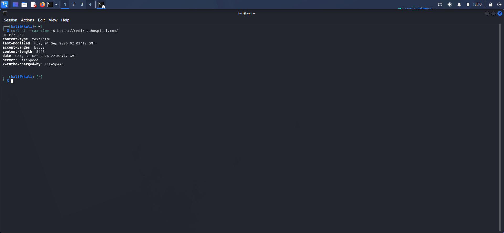
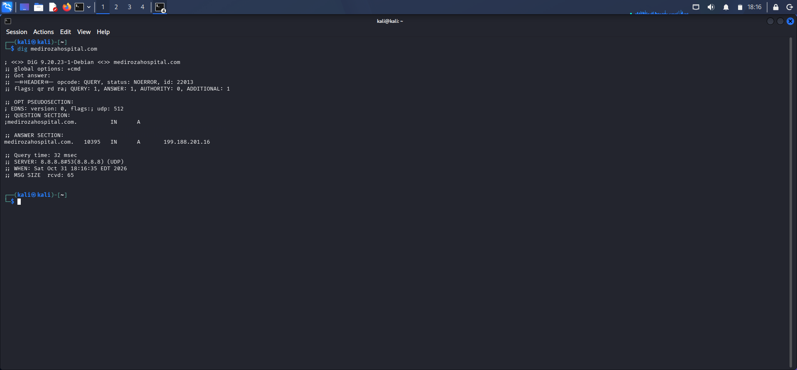
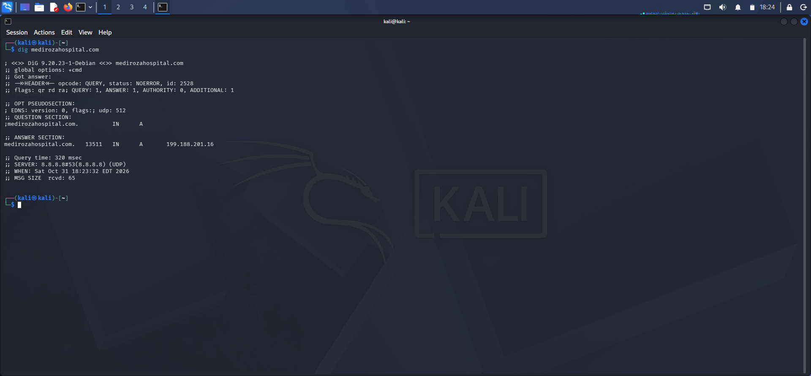
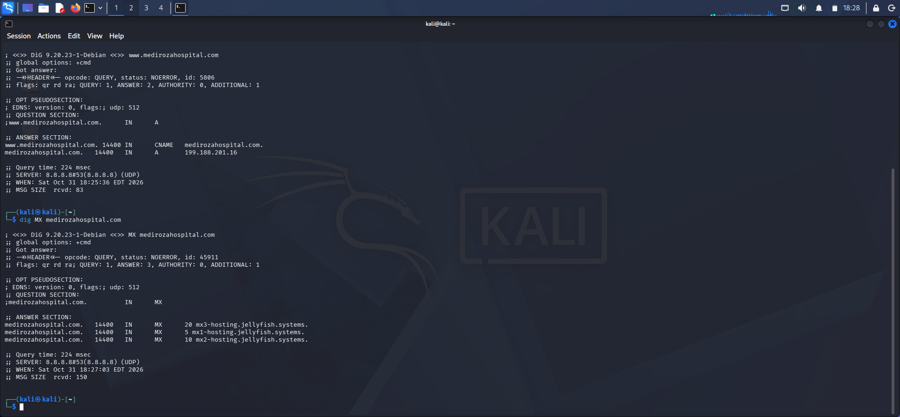
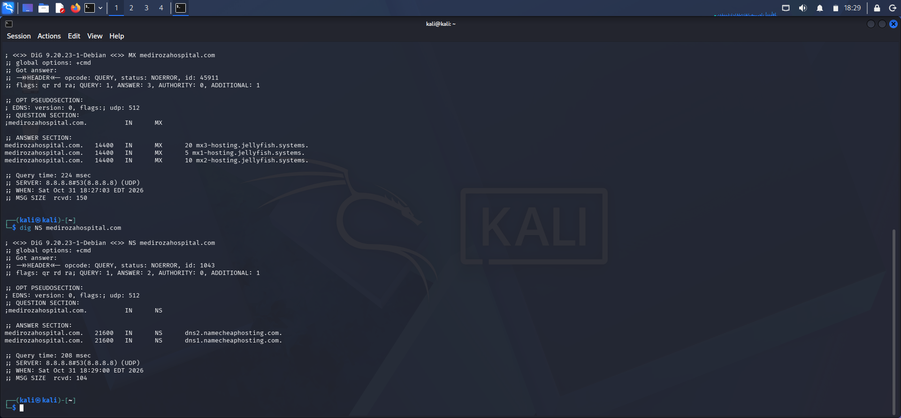
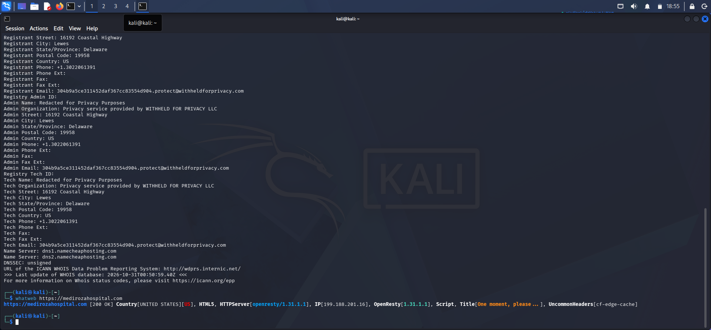

# Networkwalks-B083--Week4-Cybersecurity--Mediroza-General-Hospital-Penetration-Test-Project

## 01. PROJECT OVERVIEW

This project documents the technical investigation and penetration testing activities undertaken against the Mediroza General Hospital web environment as part of my
Networkwalks cybersecurity training.
The exercise involved examining the target's externally observable infrastructure, identifying exposed network services, analysing web application behaviour, and 
investigating potential weaknesses in authentication and accesscontrol mechanisms.
Rather than treating the exercise as a collection of isolated commands, the assessment followed a progressive investigation process in which information gathered 
during reconnaissance informed subsequent testing activities.
Particular attention was given to the security implications of exposing healthcare related resources, where weaknesses in authentication and access control can have
serious confidentiality implications.

## 02. PROJECT OBJECTIVES

The assessment was designed to:

1) Establish the target's externally observable infrastructure.
2) Identify domain registration information and DNS configurations.
3) Fingerprint the web technology stack.
4) Identify exposed TCP services and their associated service information.
5) Examine publicly accessible website configuration resources.
6) Assess authentication responses for account enumeration weaknesses.
7) Investigate potentially unsafe handling of user supplied input.
8) Examine patient portal authentication and access control security.
9) Evaluate password security mechanisms within the authorized assessment environment.
10) Document findings and develop appropriate security recommendations.

## 03. SCOPE AND METHODOLOGY

The investigation was organised into the following phases:

| Phase | Assessment activity |
|---|---|
| Phase 1 | Reconnaissance |
| Phase 2 | DNS enumeration |
| Phase 3 | Network scanning and service identification |
| Phase 4 | Web technology identification |
| Phase 5 | Web resource inspection |
| Phase 6 | Authentication and input validation assessment |
| Phase 7 | Access-control analysis |
| Phase 8 | Password-security analysis |
| Phase 9 | Findings and remediation |

# Assessment limitation: 
Findings involving authentication bypass, patient records, or confidential documents must be treated as unverified outside an explicitly authorised test environment. 
No patient records, credentials, session tokens, or password hashes are included in this public repository.

## 04. PHASE ONE – RECONNAISSANCE

### 4.1 WHOIS Information Gathering

# Objective

The initial investigation focused on retrieving publicly available domain registration information to establish the target's registration related details and identify 
its authoritative nameservers.

# Tool: WHOIS

# Command:
```
bash
whois medrosahospital.com
```

# Observed findings:

1) Registration privacy protection was indicated.
2) Privacy service identified: Withheld for Privacy LLC.
- Nameserver 1: dns1.namecheaphosting.com
- Nameserver 2: dns2.namecheaphosting.com

# Technical interpretation

The use of registration privacy protection limits the visibility of registrant information through public WHOIS records.

The nameserver information provides useful infrastructure context and establishes a starting point for subsequent DNS enumeration.

### 4.2 Web Technology Fingerprinting – WhatWeb

# Objective

Following domain registration analysis, technology fingerprinting was performed to identify information exposed by the target's web server.

# Tool: WhatWeb

# Command:
```
bash
whatweb medrosahospital.com
```

# Observed output:
```
text
HTTP Status: 200 OK
Country: UNITED STATES (US)
HTML Version: HTML5
HTTP Server: openresty/1.31.1.1
IP Address: 199.188.201.16
OpenResty: 1.31.1.1
```
# Technical interpretation

The response identified OpenResty as the exposed HTTP server technology.

The HTTP 200 response indicated that the server returned a successful HTTP response to the request.

The page title and server fingerprint provided additional information about the application's externally observable behaviour.

Technology fingerprinting is useful during reconnaissance because it helps establish the technologies and infrastructure components that may require further security review.

## 05. PHASE TWO – DNS ENUMERATION

### 5.1 DNS Information Gathering

# Objective

DNS enumeration was conducted to investigate the domain's publicly available DNS information and identify records associated with its infrastructure.

# Tools: Kali Linux DNS utilities.

# Command:
```
bash
dig medrosahospital.com


bash
dig A medrosahospital.com


bash
dig NS medrosahospital.com
```

# Investigation focus:

1) A records and IP resolution.
2) Nameserver records.
3) DNS response information.
4) Publicly observable domain infrastructure.


## 06. PHASE THREE – NETWORK SCANNING AND SERVICE ENUMERATION

### 6.1 Nmap Network Assessment

# Objective

Network scanning was performed to identify externally exposed TCP ports and determine which services were responding on the target IP address.

# Tool: Nmap

# Target IP: 199.188.201.16

# Reported open TCP ports:

| Port | Protocol | Common service association |
|---|---|---|
| 21 | TCP | FTP |
| 26 | TCP | Non-standard service; requires identification |
| 53 | TCP | DNS |
| 80 | TCP | HTTP |
| 110 | TCP | POP3 |
| 143 | TCP | IMAP |
| 443 | TCP | HTTPS |
| 465 | TCP | SMTP over implicit TLS |
| 993 | TCP | IMAP over TLS |
| 999 | TCP | Non-standard service; requires identification |

# Why ports 80 and 443 were specifically examined

Ports 80 and 443 were selected for targeted web-service enumeration because they are the conventional ports associated with HTTP and HTTPS communication.

# Port 80 – HTTP

The investigation of port 80 was intended to establish whether the target exposed an unencrypted HTTP service, examine its response headers, and determine
whether requests were redirected to a secure endpoint.

# Port 443 – HTTPS

Port 443 was examined to investigate the encrypted web service, inspect its HTTP response headers and page title, and establish additional information about the 
externally accessible application.

Examining both ports provides a clearer understanding of the target's web facing attack surface.

# Targeted Nmap command:
```
bash
nmap -sV --script=http-title,http-headers -p 80,443 199.188.201.16
```
# Technical interpretation

The initial scan provided an overview of the exposed TCP services. The subsequent targeted scan narrowed the investigation to the two principal web service ports.

Service identification is important because an exposed port alone does not establish the precise application or its security posture. Additional service level analysis
is necessary.

*Scan limitation*

The intensive Nmap scan terminated unexpectedly. This was recorded as a limitation of the scanning process rather than interpreted as evidence of a target side vulnerability.

## 07. PHASE FOUR – WEBSITE RESOURCE INSPECTION

### 7.1 Robots.txt Examination

# Objective

The robots.txt resource was inspected to identify publicly disclosed crawling directives and paths that website administrators had indicated should not be accessed by
search engine crawlers.

# Tool: cURL

# Command:
```
bash
curl https://medrosahospital.com/robots.txt
```

## 08. PHASE FIVE – AUTHENTICATION AND INPUT VALIDATION ASSESSMENT

### 8.1 Login Response Analysis

The login interface was examined to understand how the application handled authentication attempts involving different username inputs.

# Observed responses:

| Test condition | Application response |
|---|---|
| Unrecognised username | Username not found |
| Recognised-looking account identifier with an incorrect password | Incorrect password |

# Finding: Potential Username Enumeration

The difference between the responses suggests that the application may disclose whether an account identifier exists.

# Security implication

An attacker could potentially use these differences to identify valid account names, increasing the effectiveness of subsequent credential attacks.

### 8.2 SQL Injection Assessment

The login interface was also examined for evidence of unsafe database query handling.

A specially crafted input produced an SQL syntax-related error message.

# Observed behaviour: Database syntax warning returned by the application.

# Potential vulnerability: Improper handling of user-supplied input in database operations.

# Security implications

Database errors exposed to users can reveal implementation details. If untrusted input is incorporated into SQL statements without safe parameterisation, the 
application may be susceptible to SQL injection.

A database error alone is not sufficient to establish exploitability; validation must be conducted within an authorised environment.

## 09. PHASE SIX – PATIENT PORTAL AND DATA PROTECTION ANALYSIS

The patient portal was an important component of the security investigation because of the sensitivity of the information it was designed to protect.

The reported assessment raised concerns about the effectiveness of authentication and the protection of patient documents.

# Security considerations:

1) Whether portal access is restricted to authenticated users.
2) Whether users can access only records they are authorised to view.
3) Whether document retrieval is subject to server-side authorisation.
4) Whether sensitive files are exposed through predictable or publicly accessible locations.
5) Whether access to patient records is properly logged.

# Reported observation: Three patient-document files were encountered during the exercise.

Their contents, filenames, identifying information, and credentials are deliberately excluded from this public repository.

# Potential impact

Unauthorised access to healthcare records can result in serious breaches of patient confidentiality, privacy obligations, and organisational trust.

## 10. PHASE SEVEN – PASSWORD SECURITY ANALYSIS

Password security analysis was included as part of the investigation into credential protection.

# Tools used:

1) John the Ripper (JTR).
2) Johnny graphical interface.
3) Hash calculator.

The exercise involved examining password hash handling and using password auditing tools within the relevant authorized test context.

# Technical relevance

Password hashes are representations of passwords produced by cryptographic hashing functions. Password auditing helps evaluate whether password choices and
storage practices provide adequate resistance to guessing attacks.

A sound password-security implementation should use a dedicated password-hashing algorithm with appropriate computational cost and unique salts.

## 11. FINDINGS AND RISK ASSESSMENT

| ID | Finding | Initial risk consideration |
|---|---|---|
| F-01 | Username enumeration | Medium |
| F-02 | Database error disclosure | Medium |
| F-03 | Potential SQL injection | High |
| F-04 | Reported authentication-control failure | Critical |
| F-05 | Potential patient-document exposure | Critical |
| F-06 | Externally exposed services requiring review | Informational |

These are preliminary classifications. Final severity must be based on validated exploitability, affected assets, business impact, and the assessment's authorised scope.

## 12. REMEDIATION AND SECURITY RECOMMENDATIONS

### Authentication Security

1) Implement consistent login failure messages.
2) Apply rate limiting to authentication endpoints.
3) Introduce appropriate multi-factor authentication.
4) Implement secure session management.

### Database Security

1) Use parameterised queries and prepared statements.
2) Validate and safely handle user supplied input.
3) Prevent database errors from being exposed to end users.
4) Apply least privilege database permissions.

### Access Control

1) Enforce server-side authorisation for every protected resource.
2) Ensure patient records are accessible only to authorized users.
3) Prevent direct access to protected documents without proper authorization.
4) Maintain audit logs of sensitive resource access.

### Network and Infrastructure Security

1) Review all externally exposed services.
2) Disable unnecessary services.
3) Restrict administrative interfaces.
4) Enforce secure communication.
5) Regularly review service configurations and security patches.

### Data Protection

1) Encrypt sensitive information at rest and in transit.
2) Apply appropriate data retention policies.
3) Monitor unusual document access patterns.
4) Establish procedures for identifying and responding to data exposure.

## 13. PROJECT CONCLUSION

The Medrosa General Hospital penetration testing exercise provided an opportunity to examine the relationship between infrastructure exposure, web application 
behavior, authentication controls, and sensitive data protection.
The investigation progressed from domain reconnaissance and service enumeration into application-level security analysis.
The reported authentication and data-access observations demonstrate why healthcare applications require particularly strong identity verification, server-side authorization, secure database interaction, and confidentiality controls.
The exercise reinforced the importance of evidence-based vulnerability assessment: identifying a potential weakness is only the beginning; understanding its technical
significance, validating its impact, and recommending appropriate remediation are equally important parts of a penetration testing engagement.

## 14. EVIDENCE DIRECTORY










Sensitive information must be redacted before any evidence is published.

## 15. SKILLS ACQUIRED

- Open source intelligence and reconnaissance.
- Domain and DNS analysis.
- Network scanning and service enumeration.
- Web technology fingerprinting.
- HTTP and HTTPS service assessment.
- Authentication-response analysis.
- SQL injection concepts and secure input handling.
- Access control assessment.
- Password-hash security concepts.
- Vulnerability documentation and risk analysis.
- Technical reporting and remediation planning.

## 16. TOOLS USED

| Tool | Purpose |
|---|---|
| Kali Linux | Security assessment environment |
| WHOIS | Domain registration investigation |
| WhatWeb | Web technology fingerprinting |
| Nmap | Network scanning and service enumeration |
| dig | DNS record investigation |
| cURL | HTTP resource inspection |
| Johnny | Graphical interface for John the Ripper |
| John the Ripper | Password auditing |
| Hash calculator | Hash analysis |
| Burp Suite Repeater | HTTP request and response analysis, where used |

## 17. Ethical Considerations
The assessment was conducted within the authorized scope, respecting patient confidentiality and data privacy.
No unauthorized access, disclosure, or modification of sensitive medical records was permitted. Any identified vulnerabilities should be reported responsibly
to the appropriate hospital authority.

## 18. AUTHOR

Chibueze Ifeoma Increase

Cybersecurity Intern | Networkwalks Cybersecurity Program | B083 | Week 4 |

LinkedIn: https://www.linkedin.com/in/ifeoma-chibueze-9774a4406
